# ExpenseSync

ExpenseSync is a mobile expense reporting app for employees who need to log expenses while away from a reliable network connection. The .NET MAUI app stores expenses in a local SQLite database on the device. Changes made offline are queued on the device and pushed to a central ASP.NET Core API (which has its own SQLite database) when the user taps Sync now. Pulling other users' changes back down comes in later weeks.

## Week 1 Progress: Planning & Setup

### Domain entity

The app has one entity, `Expense`:

| Field | Type | Notes |
|---|---|---|
| `ExpenseId` | `Guid` | Generated on the device, so an expense can be created without contacting the server |
| `Description` | `string` | What the expense was for |
| `Amount` | `decimal` | Expense amount |
| `ExpenseDate` | date | Day the expense happened |

### MAUI project

- Created `src/ExpenseSync.App` from the .NET 11 MAUI template, using AppShell.
- Added CommunityToolkit.Mvvm. The home page (`MainPage`) gets `MainViewModel` through constructor injection, and both are registered in `MauiProgram.cs`.

### Local SQLite

- Added `sqlite-net-pcl`.
- `Data/ExpenseDatabase.cs` opens `expensesync.db3` in `FileSystem.AppDataDirectory` with `SQLiteAsyncConnection` and creates the `Expenses` table.
- The home page shows "Ready" when the local database opens, along with the file's location.

### Server API

- Created `src/ExpenseSync.Api`, an ASP.NET Core Minimal API.
- Uses Entity Framework Core with SQLite (`ExpenseSyncDbContext`). The connection string is in `appsettings.json`, and an `InitialCreate` migration creates `expensesync-server.db` with an `Expenses` table when the API starts.
- `GET /` checks that the API is running, and `GET /health` checks that it can reach the server database.
- The MAUI app does not connect to the API yet.

### Solution layout

```text
ExpenseSync/
├── src/
│   ├── ExpenseSync.App/   .NET MAUI app + local SQLite
│   └── ExpenseSync.Api/   ASP.NET Core API + server SQLite
├── global.json            .NET 11 SDK version
└── ExpenseSync.slnx
```

### Verified

- The solution builds with no warnings or errors.
- The API starts, creates the server database, and `/health` reports the database as connected.
- The MAUI app runs on Windows, shows "Ready", and creates `expensesync.db3` with the `Expenses` table.

## Week 2 Progress: Local CRUD + Change Tracking

This week the app went from "opens a database" to a working expense list that can add, edit, and delete records on the device, with every change recorded in a `PendingChanges` table for later sync. Nothing talks to the API yet.

### Create, update, delete

The home page is now an expense list. Add Expense opens `ExpenseEditPage` with an empty form. Tapping a row opens the same page filled in, with a Delete button that asks for confirmation. Save and Delete are commands on `ExpenseEditViewModel`; they call `ExpenseDatabase` and then navigate back, and the list reloads in `OnAppearing`.

Everything reads and writes the local SQLite file only. There is no network check, so this all works with the device offline.

Two columns were added to `Expenses`:

- `LastModifiedUtc`: set to `DateTime.UtcNow` whenever the row is created, edited, or deleted.
- `IsDeleted`: deleted expenses stay in the table with this set to `1` (a tombstone) so the delete can be sent to the server later. The list only shows rows where it is `0`.

`DateTime` values are now stored as ISO text instead of ticks so the tables are readable in `sqlite3`.

### Change tracking

`PendingChanges` holds one row for each expense that has a change the server has not seen:

| Column | Notes |
|---|---|
| `PendingChangeId` | `Guid` |
| `ExpenseId` | The expense that changed |
| `Operation` | `Create`, `Update`, or `Delete`, stored as text |
| `CapturedAtUtc` | When the user made the change on this device, in UTC |
| `DeviceId` | Hardcoded to `device-01` in `DeviceSettings.cs`. Each group member builds with a different value |

Every write goes through `ExpenseDatabase`. The expense row and its pending row are written inside one `RunInTransactionAsync` call, so the database cannot end up with an edited expense and no pending row, or the other way around.

```text
ExpenseEditViewModel.SaveCommand / DeleteCommand
        |
        v
ExpenseDatabase.CreateExpenseAsync / UpdateExpenseAsync / DeleteExpenseAsync
        |   one SQLite transaction
        |-- insert or update the Expenses row, set LastModifiedUtc
        '-- insert or update the PendingChanges row for that ExpenseId
        |
        v
MainViewModel.LoadExpensesCommand reloads the list and pending count
```

Rather than keeping a history of operations, each expense has at most one pending row and the operation is adjusted as the user keeps editing:

| Pending row already there | User does | Result |
|---|---|---|
| none | create | `Create` |
| none | update | `Update` |
| none | delete | `IsDeleted = 1`, pending `Delete` |
| `Create` | update | still `Create`; `CapturedAtUtc` moves forward. The server only needs the final version |
| `Create` | delete | both rows removed. The server never knew about this expense |
| `Update` | update | still `Update`; `CapturedAtUtc` moves forward |

(Week 3 change: when a pending row is reused like this, it now also gets a new `PendingChangeId`. See "Retries and re-edits" under Week 3.)
| `Update` | delete | `IsDeleted = 1`, pending row changes to `Delete` |

The app never removes pending rows on its own yet. That happens in Week 3 once the server acknowledges a push.

The home page shows the row count as "Pending changes (not synced yet)" so it is easy to see tracking happen without opening the database.

### Screenshots

Taken on Windows starting from a fresh database. The table dumps are `sqlite3` reading the same `expensesync.db3` file whose path is printed at the bottom of the app.

#### Before any change

| Device UI | Device tables |
|---|---|
| 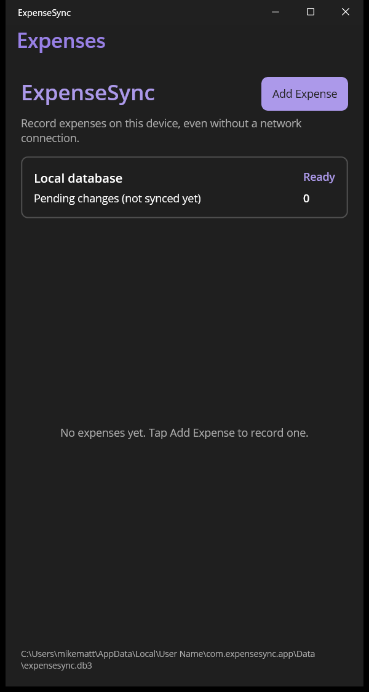 | 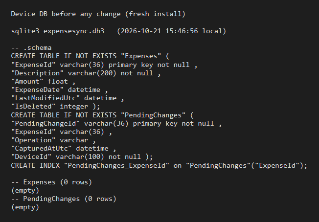 |

Empty list, pending count 0, both tables exist with no rows. The schema dump shows the new `LastModifiedUtc` and `IsDeleted` columns and the `PendingChanges` table.

#### Create

| Add form filled in | After saving two expenses |
|---|---|
|  | 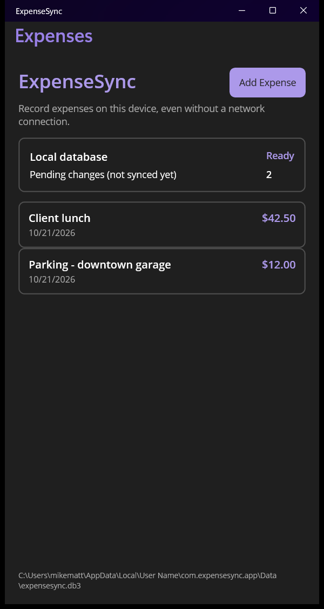 |

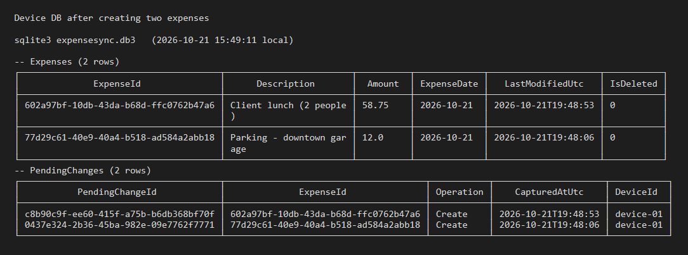

Each save added one `Expenses` row and one `PendingChanges` row with `Operation = Create`. The `ExpenseId` values line up across the two tables and `CapturedAtUtc` matches the expense's `LastModifiedUtc`.

#### Update

| Edit form (opened by tapping the row) | After saving the edit |
|---|---|
| 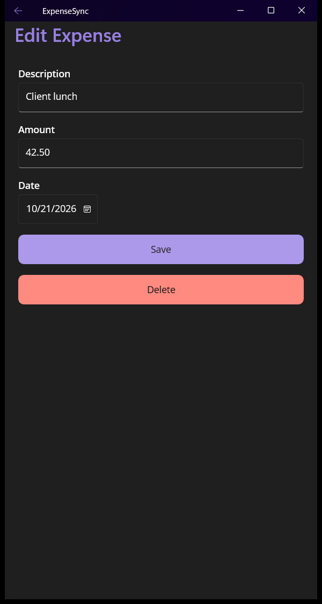 |  |

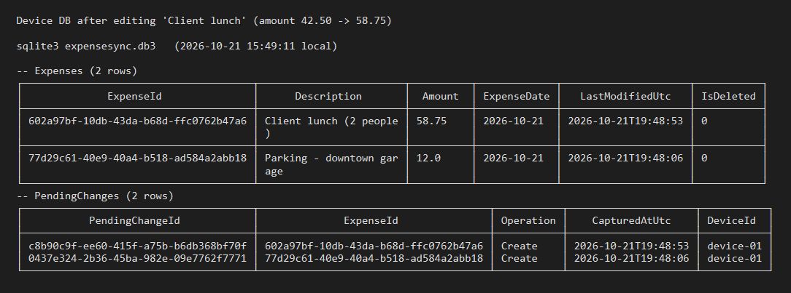

The description and amount changed and `LastModifiedUtc` moved forward. This expense had never been synced, so its pending row stayed `Create` with the newer timestamp instead of adding a second row, and the count stayed at 2.

To show an update on an expense the server already has, I cleared `PendingChanges` with `sqlite3` (standing in for a finished sync, since push is Week 3) and edited the amount again:

| After editing a "synced" expense | Device tables |
|---|---|
|  | 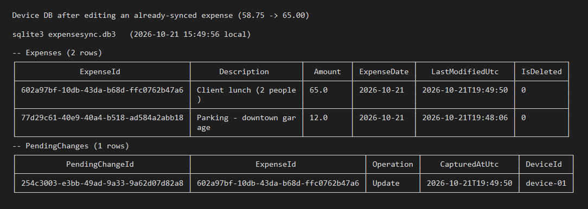 |

This time a pending row with `Operation = Update` was written.

#### Delete

| Confirmation | After delete |
|---|---|
| 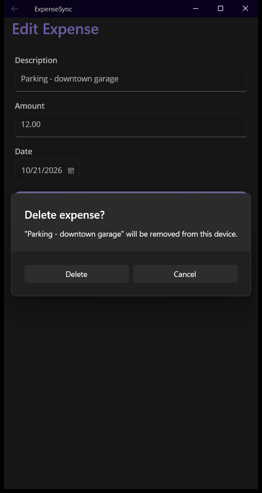 | 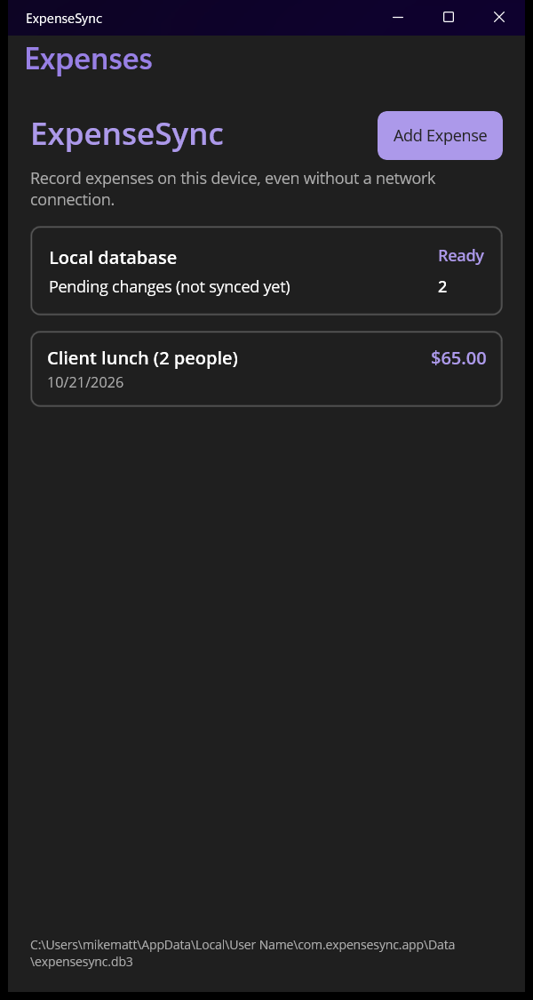 |

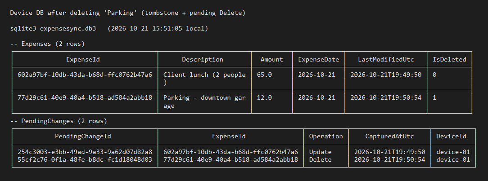

Parking is gone from the list, but its row is still in `Expenses` with `IsDeleted = 1`. A `Delete` pending row was added, so the count is back to 2: one `Update`, one `Delete`.

### Files touched

- `Models/Expense.cs`: added `LastModifiedUtc` and `IsDeleted`
- `Models/PendingChange.cs`, `Models/ChangeOperation.cs`: new
- `DeviceSettings.cs`: new, holds the hardcoded `DeviceId`
- `Data/ExpenseDatabase.cs`: CRUD methods, each writing the expense and its pending row in one transaction
- `ViewModels/MainViewModel.cs`, `Views/MainPage.xaml`: list, pending count, Add button, tap to edit
- `ViewModels/ExpenseEditViewModel.cs`, `Views/ExpenseEditPage.xaml`: new add/edit page
- `AppShell.xaml.cs`, `MauiProgram.cs`: route and DI registration for the edit page

### Not done yet

- Nothing is sent to the API. `PendingChanges` only grows. Push is Week 3.
- No audit log (Week 5).
- `DeviceId` is a compile-time constant.

## Week 3 Progress: Push Sync

This week the device started sending its pending changes to the API. Tapping Sync now posts every `PendingChanges` row to `POST /api/sync/push`. The server saves them in a `ReceivedChanges` inbox and replies with the IDs it accepted, and the device deletes only those pending rows. A second endpoint, `POST /api/sync/process`, applies the inbox to the server's `Expenses` table.

### Push endpoint

`POST /api/sync/push` (`Endpoints/SyncEndpoints.cs`)

```json
{
  "deviceId": "device-01",
  "changes": [
    {
      "pendingChangeId": "39a8249e-2b8e-4caf-98e7-691689337973",
      "expenseId": "8bcf3d32-c624-4372-a0f0-2154b9233445",
      "operation": "Update",
      "capturedAtUtc": "2026-10-29T03:25:11.270Z",
      "expense": {
        "description": "Client lunch",
        "amount": 48.75,
        "expenseDate": "2026-10-28",
        "lastModifiedUtc": "2026-10-29T03:25:11.270Z"
      }
    }
  ]
}
```

Response: `{ "acceptedPendingChangeIds": [ ... ], "serverTimeUtc": "..." }`

- `expense` is required for `Create` and `Update` and is `null` for `Delete`. A request that is missing `deviceId` or an expense payload gets a `400` validation problem.
- Each change becomes one `ReceivedChanges` row with `IsProcessed = 0`. Push only stores the changes and does not touch `Expenses`.
- If a `PendingChangeId` is already in `ReceivedChanges` (the device retried after losing the response), the server does not insert it again, but it still lists the ID as accepted so the device can clear it.

### Process endpoint

`POST /api/sync/process` reads every unprocessed `ReceivedChanges` row ordered by `CapturedAtUtc` and applies it to `Expenses`:

- `Create`/`Update`: insert the expense, or overwrite it if it exists
- `Delete`: set `IsDeleted = 1` (a tombstone, same as on the device)

It then sets `IsProcessed = 1` and `ProcessedAtUtc` on each row. Because receiving and processing are separate steps, the server keeps a record of what each device sent. The conflict handling and audit log in later weeks will use that record. For now, process is called by hand (from `ExpenseSync.Api.http` or `curl`). Last-captured-wins conflict handling is not applied yet (Week 5).

### Server tables

Migration `AddSyncTracking` added `LastModifiedUtc`, `IsDeleted`, and `LastDeviceId` to `Expenses` and created `ReceivedChanges`:

| Column | Notes |
|---|---|
| `PendingChangeId` | Primary key. The same ID the device generated, which is what makes a retried push safe |
| `ExpenseId`, `DeviceId`, `Operation`, `CapturedAtUtc` | Copied from the push |
| `Description`, `Amount`, `ExpenseDate`, `LastModifiedUtc` | Expense values as they were when sent (empty for `Delete`) |
| `IsProcessed`, `ProcessedAtUtc` | Set by `/api/sync/process` |

Migration `StoreOperationAsText` changed `Operation` from an integer to text (`Create`/`Update`/`Delete`) to match the device table and make the inbox readable in `sqlite3`. Existing rows are converted by the migration.

### Sending and clearing pending changes on the device

```text
MainPage "Sync now"  ->  MainViewModel.SyncNowCommand
        |
        v
SyncService.PushAsync
        |-- read all PendingChanges rows
        |-- attach the current Expense values for Create/Update
        |-- POST api/sync/push  (typed HttpClient, 15 s timeout)
        |
        |-- success: ExpenseDatabase.ClearPendingChangesAsync(acceptedIds)
        |       |-- delete only the PendingChanges rows the server accepted
        |       '-- hard-delete tombstoned expenses whose Delete was accepted
        |
        '-- failure (no connection, timeout, bad response): change nothing
        |
        v
status message + reload list and pending count
```

- The Sync now button is disabled while a sync is running, and the result ("Synced 3 change(s).", "Sync failed: ... Pending changes were kept.") is shown under it.
- Pending rows are only removed after the server says it has them, so tapping Sync now while the API can't be reached leaves the count unchanged. The changes go on the next successful sync.
- If the server accepts only some of the changes, only those are cleared and the message says how many are still pending.
- `SyncSettings.BaseUrl` is `http://localhost:5157/` on Windows and `http://10.0.2.2:5157/` on the Android emulator.

### Retries and re-edits

Testing the merged branch turned up three problems, now fixed:

1. Retry after a lost response: the server skipped `PendingChangeId`s it already had but didn't list them as accepted, so the device never cleared them and they stayed pending forever. The server now acknowledges them again (see above).
2. Edit after a push whose response was lost: the device used to keep the same `PendingChangeId` when it folded a new edit into an existing pending row. If the server had already stored that ID, the newer edit would be treated as a duplicate and silently dropped. `ExpenseDatabase.ReplacePendingChange` now gives the row a new `PendingChangeId` every time it changes, so the server always sees the newest version as a new change. This also covers an edit made while a sync is in flight: the server's acknowledgement is for the old ID, so the new pending row is not cleared.
3. Amount precision: sqlite-net stores `decimal` as a floating-point `REAL`, so an amount read back from the device database can carry binary rounding noise into the `decimal` sent to the server. `SyncService` rounds the amount to 2 decimal places before sending.

### Screenshots

Taken on Windows from a fresh device database and a fresh server database. To give the server something to start from, I first created "Client lunch" ($42.50) and "Parking - downtown garage" ($18.00) in the app, tapped Sync now, and called `/api/sync/process`. The table dumps read `expensesync-server.db` in `src/ExpenseSync.Api` and the device's `expensesync.db3`.

#### 1. Server tables before changes are pushed

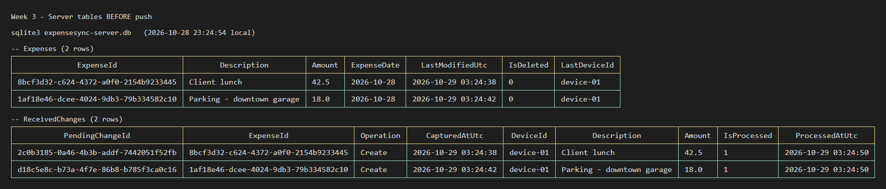

The server has the two seeded expenses, and both of their `Create` rows in `ReceivedChanges` are already processed.

#### 2. Pending changes on the device waiting to be synced

| Device UI | Device tables |
|---|---|
|  | 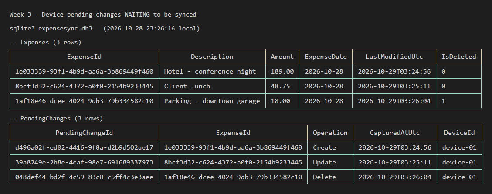 |

Then I made three changes on the device without syncing:

- Added "Hotel - conference night" ($189.00): `Create`
- Changed Client lunch from $42.50 to $48.75: `Update`
- Deleted Parking: `Delete`, and the row stays in `Expenses` with `IsDeleted = 1`

The pending count is 3.

#### 3. Pending changes on the device after a successful send

| Device UI | Device tables |
|---|---|
| 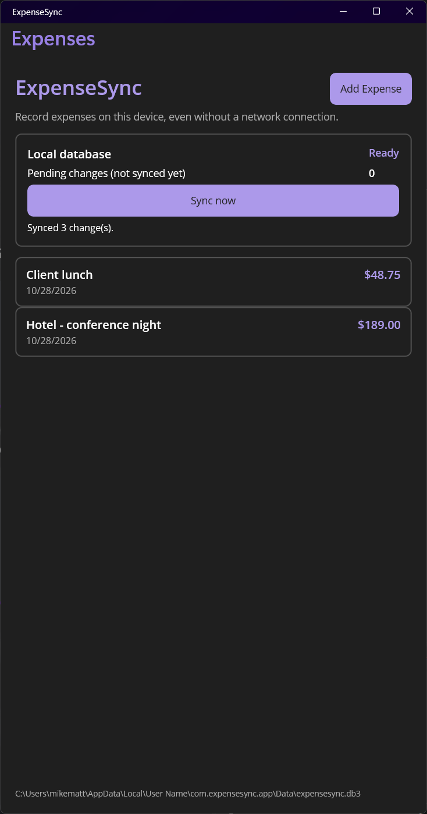 | 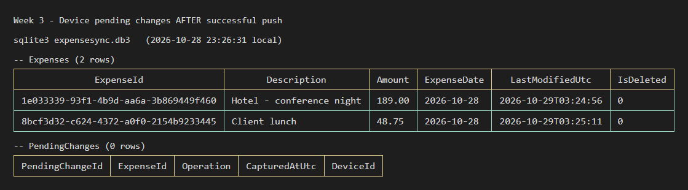 |

After Sync now, the server accepted all three `PendingChangeId`s, so `PendingChanges` is empty and the count is 0. The Parking tombstone was also removed from the device because the server now has the delete.

#### 4. Server tables after receiving the changes

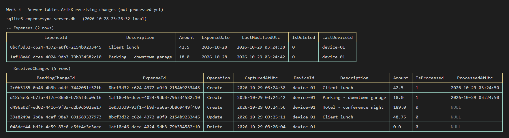

`ReceivedChanges` has three new rows with the same `PendingChangeId`s the device sent, all with `IsProcessed = 0`. The server stores GUIDs in upper case; the dump shows them in lower case so they match the device. `Expenses` has not changed yet: Client lunch is still $42.50 and Parking is not deleted.

#### 5. Server tables after processing the changes

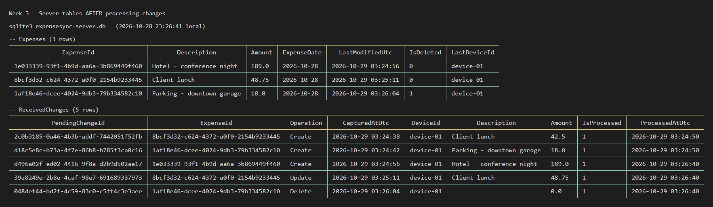

After `POST /api/sync/process` (`{"processedCount":3}`):

- Hotel was added
- Client lunch is $48.75 with the device's `LastModifiedUtc`
- Parking has `IsDeleted = 1`

Every `ReceivedChanges` row now has `IsProcessed = 1` and a `ProcessedAtUtc`.

### Other testing

- With the API stopped, Sync now showed "Sync failed: ... Pending changes were kept." and the pending rows were unchanged. Starting the API and tapping Sync now sent them.
- A Python script sent the push and process requests directly and checked the database after each one: creates stored unprocessed with `Expenses` untouched, a full retry of an already stored push (same ID accepted again, no duplicate row), an empty `deviceId` (`400`), an `Update` with no payload (`400`), processing creates, then pushing and processing an update and a delete. All 13 checks passed.

### Files touched

API:

- `Endpoints/SyncEndpoints.cs`: new, push and process endpoints
- `Models/ReceivedChange.cs`, `Models/ChangeOperation.cs`: new
- `Models/Expense.cs`: added `LastModifiedUtc`, `IsDeleted`, `LastDeviceId`
- `Data/ExpenseSyncDbContext.cs`: `ReceivedChanges` table, `Operation` stored as text
- `Data/Migrations/*AddSyncTracking*`, `*StoreOperationAsText*`: new migrations
- `Program.cs`: maps the sync endpoints and serializes enums as strings
- `ExpenseSync.Api.http`: sample push and process requests

App:

- `Services/SyncService.cs`, `Services/SyncSettings.cs`: new, push client and base URL
- `Data/ExpenseDatabase.cs`: `GetPendingChangesAsync`, `ClearPendingChangesAsync`, new `PendingChangeId` on re-edit
- `ViewModels/MainViewModel.cs`, `Views/MainPage.xaml`: Sync now button and status text
- `MauiProgram.cs`, `ExpenseSync.App.csproj`: typed `HttpClient` registration (`Microsoft.Extensions.Http`)

### Not done yet

- Pulling server changes down to the device (Week 4).
- Conflict handling in process (Week 5). Each run applies changes in `CapturedAtUtc` order, but it does not compare against the `LastModifiedUtc` already on the server, so an older change processed in a later run can overwrite a newer one.
- `/api/sync/process` is called by hand, and sync only runs when the user taps Sync now.
- The base URL is hardcoded. A Dev Tunnel URL is needed for testing on a physical phone.
- No audit log (Week 5).
