# ExpenseSync

ExpenseSync is a mobile expense reporting app for employees who need to log expenses while away from a reliable network connection. The .NET MAUI app stores expenses in a local SQLite database on the device. Changes made offline are queued locally; Sync now or a connectivity change can push them to a central ASP.NET Core API and then download and apply server changes.

## Week 1 Progress: Planning & Setup

### Domain entity

The app has one entity, `Expense`:

| Field | Type | Notes |
|---|---|---|
| `ExpenseId` | `Guid` | Generated on the device, so an expense can be created without contacting the server |
| `Description` | `string` | What the expense was for |
| `Amount` | `decimal` | Expense amount |
| `ExpenseDate` | date | Day the expense happened |

### MAUI project

- Created `src/ExpenseSync.App` from the .NET 11 MAUI template, using AppShell.
- Added CommunityToolkit.Mvvm. The home page (`MainPage`) gets `MainViewModel` through constructor injection, and both are registered in `MauiProgram.cs`.

### Local SQLite

- Added `sqlite-net-pcl`.
- `Data/ExpenseDatabase.cs` opens `expensesync.db3` in `FileSystem.AppDataDirectory` with `SQLiteAsyncConnection` and creates the `Expenses` table.
- The home page shows "Ready" when the local database opens, along with the file's location.

### Server API

- Created `src/ExpenseSync.Api`, an ASP.NET Core Minimal API.
- Uses Entity Framework Core with SQLite (`ExpenseSyncDbContext`). The connection string is in `appsettings.json`, and an `InitialCreate` migration creates `expensesync-server.db` with an `Expenses` table when the API starts.
- `GET /` checks that the API is running, and `GET /health` checks that it can reach the server database.
- The MAUI app does not connect to the API yet.

### Solution layout

```text
ExpenseSync/
├── src/
│   ├── ExpenseSync.App/   .NET MAUI app + local SQLite
│   └── ExpenseSync.Api/   ASP.NET Core API + server SQLite
├── global.json            .NET 11 SDK version
└── ExpenseSync.slnx
```

### Verified

- The solution builds with no warnings or errors.
- The API starts, creates the server database, and `/health` reports the database as connected.
- The MAUI app runs on Windows, shows "Ready", and creates `expensesync.db3` with the `Expenses` table.

## Week 2 Progress: Local CRUD + Change Tracking

The home page now lists expenses and supports local create, edit, and delete. Each change is recorded in `PendingChanges` for later sync. The app does not contact the API yet.

### Create, update, delete

The home page is now an expense list. Add Expense opens `ExpenseEditPage` with an empty form. Tapping a row opens the same page filled in, with a Delete button that asks for confirmation. Save and Delete are commands on `ExpenseEditViewModel`; they call `ExpenseDatabase` and then navigate back, and the list reloads in `OnAppearing`.

Everything reads and writes the local SQLite file only. There is no network check, so this all works with the device offline.

Two columns were added to `Expenses`:

- `LastModifiedUtc`: set to `DateTime.UtcNow` whenever the row is created, edited, or deleted.
- `IsDeleted`: deleted expenses stay in the table with this set to `1` (a tombstone) so the delete can be sent to the server later. The list only shows rows where it is `0`.

`DateTime` values are now stored as ISO text instead of ticks so the tables are readable in `sqlite3`.

### Change tracking

`PendingChanges` holds one row for each expense that has a change the server has not seen:

| Column | Notes |
|---|---|
| `PendingChangeId` | `Guid` |
| `ExpenseId` | The expense that changed |
| `Operation` | `Create`, `Update`, or `Delete`, stored as text |
| `CapturedAtUtc` | When the user made the change on this device, in UTC |
| `DeviceId` | Hardcoded to `device-01` in `DeviceSettings.cs`. Each group member builds with a different value |

Every write goes through `ExpenseDatabase`. The expense row and its pending row are written inside one `RunInTransactionAsync` call, so the database cannot end up with an edited expense and no pending row, or the other way around.

```text
ExpenseEditViewModel.SaveCommand / DeleteCommand
        |
        v
ExpenseDatabase.CreateExpenseAsync / UpdateExpenseAsync / DeleteExpenseAsync
        |   one SQLite transaction
        |-- insert or update the Expenses row, set LastModifiedUtc
        '-- insert or update the PendingChanges row for that ExpenseId
        |
        v
MainViewModel.LoadExpensesCommand reloads the list and pending count
```

Rather than keeping a history of operations, each expense has at most one pending row and the operation is adjusted as the user keeps editing:

| Pending row already there | User does | Result |
|---|---|---|
| none | create | `Create` |
| none | update | `Update` |
| none | delete | `IsDeleted = 1`, pending `Delete` |
| `Create` | update | still `Create`; `CapturedAtUtc` moves forward. The server only needs the final version |
| `Create` | delete | both rows removed. The server never knew about this expense |
| `Update` | update | still `Update`; `CapturedAtUtc` moves forward |

(Week 3 change: when a pending row is reused like this, it now also gets a new `PendingChangeId`. See "Retries and re-edits" under Week 3.)
| `Update` | delete | `IsDeleted = 1`, pending row changes to `Delete` |

The app never removes pending rows on its own yet. That happens in Week 3 once the server acknowledges a push.

The home page shows the row count as "Pending changes (not synced yet)" so it is easy to see tracking happen without opening the database.

### Screenshots

Taken on Windows starting from a fresh database. The table dumps are `sqlite3` reading the same `expensesync.db3` file whose path is printed at the bottom of the app.

#### Before any change

| Device UI | Device tables |
|---|---|
| 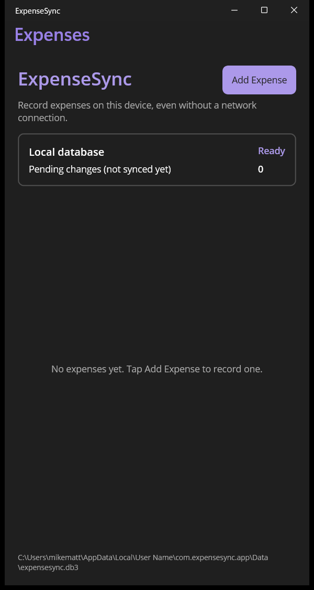 | 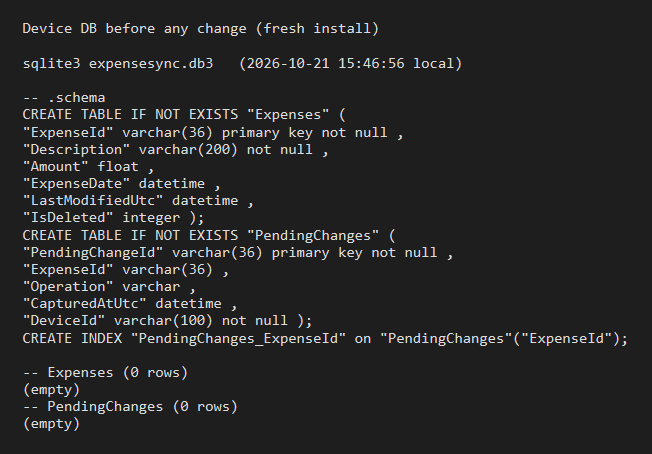 |

Empty list, pending count 0, both tables exist with no rows. The schema dump shows the new `LastModifiedUtc` and `IsDeleted` columns and the `PendingChanges` table.

#### Create

| Add form filled in | After saving two expenses |
|---|---|
| 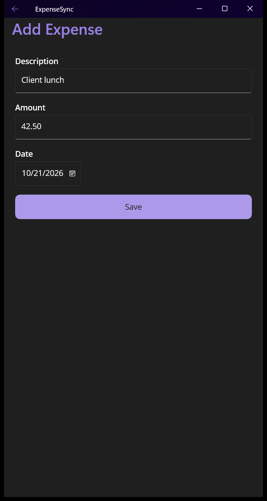 | 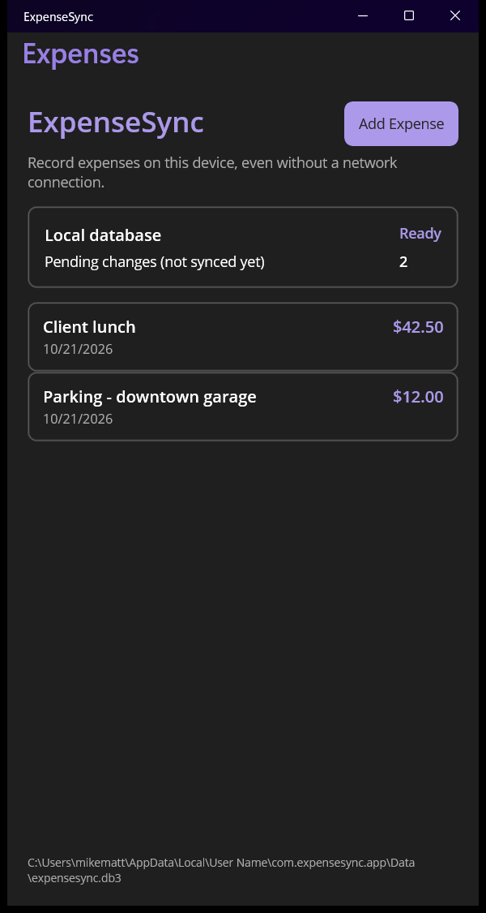 |

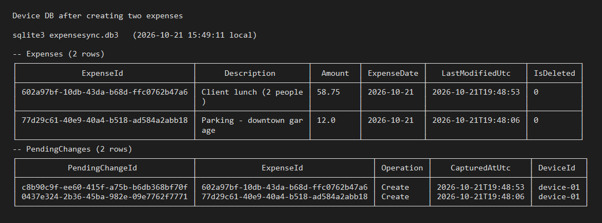

Each save added one `Expenses` row and one `PendingChanges` row with `Operation = Create`. The `ExpenseId` values line up across the two tables and `CapturedAtUtc` matches the expense's `LastModifiedUtc`.

#### Update

| Edit form (opened by tapping the row) | After saving the edit |
|---|---|
| 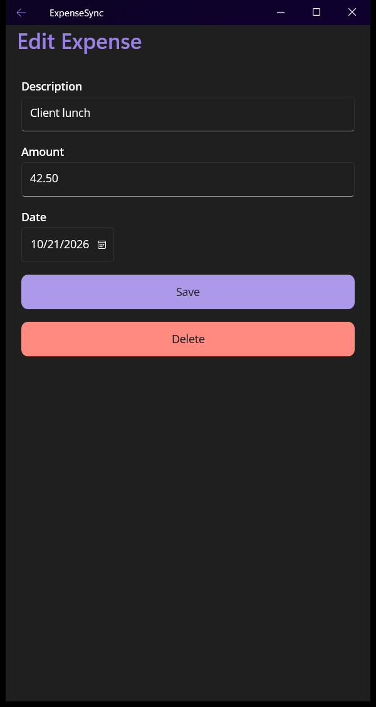 |  |

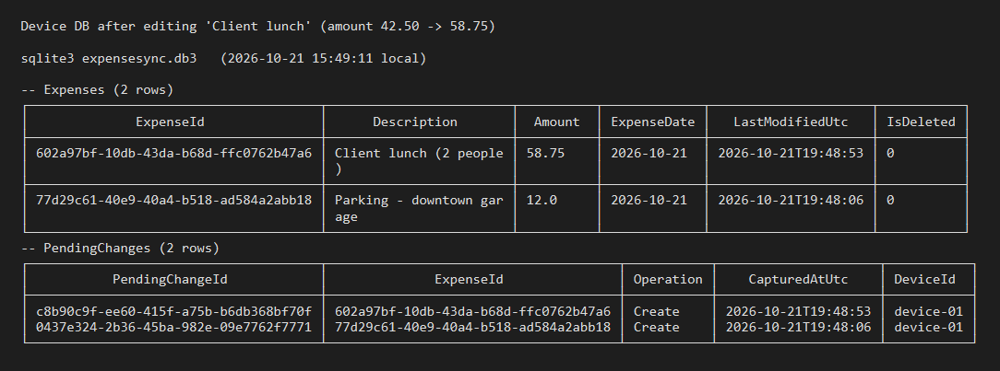

The description and amount changed and `LastModifiedUtc` moved forward. This expense had never been synced, so its pending row stayed `Create` with the newer timestamp instead of adding a second row, and the count stayed at 2.

To show an update on an expense the server already has, I cleared `PendingChanges` with `sqlite3` (standing in for a finished sync, since push is Week 3) and edited the amount again:

| After editing a "synced" expense | Device tables |
|---|---|
|  | 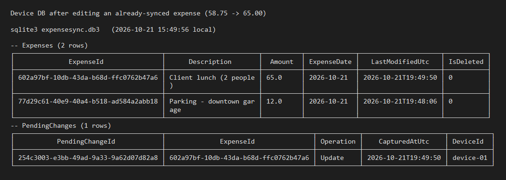 |

This time a pending row with `Operation = Update` was written.

#### Delete

| Confirmation | After delete |
|---|---|
| 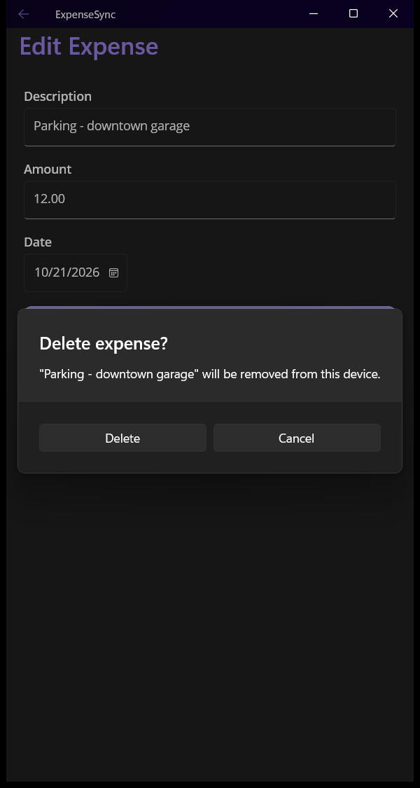 | 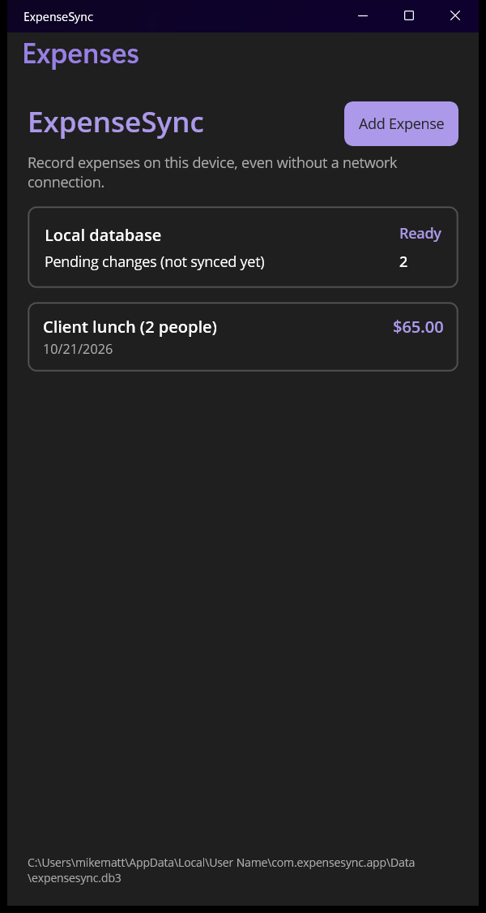 |

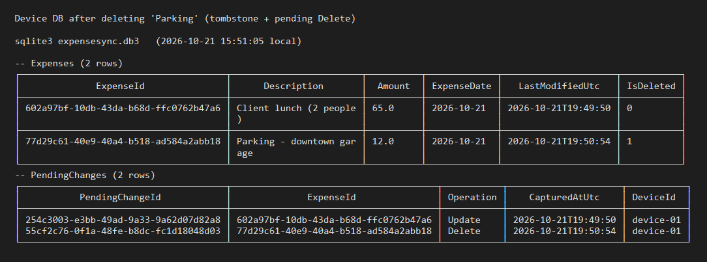

Parking is gone from the list, but its row is still in `Expenses` with `IsDeleted = 1`. A `Delete` pending row was added, so the count is back to 2: one `Update`, one `Delete`.

### Files touched

- `Models/Expense.cs`: added `LastModifiedUtc` and `IsDeleted`
- `Models/PendingChange.cs`, `Models/ChangeOperation.cs`: new
- `DeviceSettings.cs`: new, holds the hardcoded `DeviceId`
- `Data/ExpenseDatabase.cs`: CRUD methods, each writing the expense and its pending row in one transaction
- `ViewModels/MainViewModel.cs`, `Views/MainPage.xaml`: list, pending count, Add button, tap to edit
- `ViewModels/ExpenseEditViewModel.cs`, `Views/ExpenseEditPage.xaml`: new add/edit page
- `AppShell.xaml.cs`, `MauiProgram.cs`: route and DI registration for the edit page

### Not done yet

- Nothing is sent to the API. `PendingChanges` only grows. Push is Week 3.
- No audit log (Week 5).
- `DeviceId` is a compile-time constant.

## Week 3 Progress: Push Sync

In Week 3, Sync now posted each `PendingChanges` row to `POST /api/sync/push`. The server saved the changes in `ReceivedChanges` and returned the IDs it accepted. The device deleted only those pending rows. `POST /api/sync/process` applied the inbox to the server's `Expenses` table. Week 5 changes the processing and response described below.

### Push endpoint

`POST /api/sync/push` (`Endpoints/SyncEndpoints.cs`)

```json
{
  "deviceId": "device-01",
  "changes": [
    {
      "pendingChangeId": "39a8249e-2b8e-4caf-98e7-691689337973",
      "expenseId": "8bcf3d32-c624-4372-a0f0-2154b9233445",
      "operation": "Update",
      "capturedAtUtc": "2026-10-29T03:25:11.270Z",
      "expense": {
        "description": "Client lunch",
        "amount": 48.75,
        "expenseDate": "2026-10-28",
        "lastModifiedUtc": "2026-10-29T03:25:11.270Z"
      }
    }
  ]
}
```

Response: `{ "acceptedPendingChangeIds": [ ... ], "serverTimeUtc": "..." }`

- `expense` is required for `Create` and `Update` and is `null` for `Delete`. A request that is missing `deviceId` or an expense payload gets a `400` validation problem.
- In Week 3, each change became one `ReceivedChanges` row with `IsProcessed = 0`; push only stored the changes and did not touch `Expenses`.
- If a `PendingChangeId` is already in `ReceivedChanges` (the device retried after losing the response), the server does not insert it again, but it still lists the ID as accepted so the device can clear it.

### Process endpoint

`POST /api/sync/process` reads every unprocessed `ReceivedChanges` row ordered by `CapturedAtUtc` and applies it to `Expenses`:

- `Create`/`Update`: insert the expense, or overwrite it if it exists
- `Delete`: set `IsDeleted = 1` (a tombstone, same as on the device)

It then sets `IsProcessed = 1` and `ProcessedAtUtc` on each row. In Week 3, processing was called by hand and did not compare the incoming time with the server version. The Week 5 section describes automatic processing and conflict handling.

### Server tables

Migration `AddSyncTracking` added `LastModifiedUtc`, `IsDeleted`, and `LastDeviceId` to `Expenses` and created `ReceivedChanges`:

| Column | Notes |
|---|---|
| `PendingChangeId` | Primary key. The same ID the device generated, which is what makes a retried push safe |
| `ExpenseId`, `DeviceId`, `Operation`, `CapturedAtUtc` | Copied from the push |
| `Description`, `Amount`, `ExpenseDate`, `LastModifiedUtc` | Expense values as they were when sent (empty for `Delete`) |
| `IsProcessed`, `ProcessedAtUtc` | Set by `/api/sync/process` |

Migration `StoreOperationAsText` changed `Operation` from an integer to text (`Create`/`Update`/`Delete`) to match the device table and make the inbox readable in `sqlite3`. Existing rows are converted by the migration.

### Sending and clearing pending changes on the device

```text
MainPage "Sync now"  ->  MainViewModel.SyncNowCommand
        |
        v
SyncService.PushAsync
        |-- read all PendingChanges rows
        |-- attach the current Expense values for Create/Update
        |-- POST api/sync/push  (typed HttpClient, 15 s timeout)
        |
        |-- success: ExpenseDatabase.ClearPendingChangesAsync(acceptedIds)
        |       |-- delete only the PendingChanges rows the server accepted
        |       '-- hard-delete tombstoned expenses whose Delete was accepted
        |
        '-- failure (no connection, timeout, bad response): change nothing
        |
        v
status message + reload list and pending count
```

- The Sync now button is disabled while a sync is running, and the result ("Synced 3 change(s).", "Sync failed: ... Pending changes were kept.") is shown under it.
- Pending rows are only removed after the server says it has them, so tapping Sync now while the API can't be reached leaves the count unchanged. The changes go on the next successful sync.
- If the server accepts only some of the changes, only those are cleared and the message says how many are still pending.
- `SyncSettings.BaseUrl` is `http://localhost:5157/` on Windows and `http://10.0.2.2:5157/` on the Android emulator.

### Retries and re-edits

Testing the merged branch turned up three problems, now fixed:

1. Retry after a lost response: the server skipped `PendingChangeId`s it already had but didn't list them as accepted, so the device never cleared them and they stayed pending forever. The server now acknowledges them again (see above).
2. Edit after a push whose response was lost: the device used to keep the same `PendingChangeId` when it folded a new edit into an existing pending row. If the server had already stored that ID, the newer edit would be treated as a duplicate and silently dropped. `ExpenseDatabase.ReplacePendingChange` now gives the row a new `PendingChangeId` every time it changes, so the server always sees the newest version as a new change. This also covers an edit made while a sync is in flight: the server's acknowledgement is for the old ID, so the new pending row is not cleared.
3. Amount precision: sqlite-net stores `decimal` as a floating-point `REAL`, so an amount read back from the device database can carry binary rounding noise into the `decimal` sent to the server. `SyncService` rounds the amount to 2 decimal places before sending.

### Screenshots

Taken on Windows from a fresh device database and a fresh server database. To give the server something to start from, I first created "Client lunch" ($42.50) and "Parking - downtown garage" ($18.00) in the app, tapped Sync now, and called `/api/sync/process`. The table dumps read `expensesync-server.db` in `src/ExpenseSync.Api` and the device's `expensesync.db3`.

#### 1. Server tables before changes are pushed

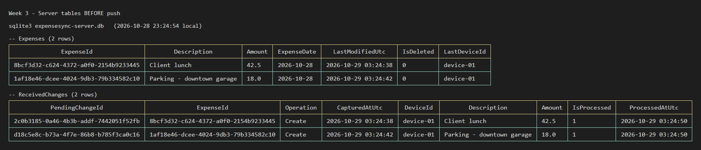

The server has the two seeded expenses, and both of their `Create` rows in `ReceivedChanges` are already processed.

#### 2. Pending changes on the device waiting to be synced

| Device UI | Device tables |
|---|---|
|  | 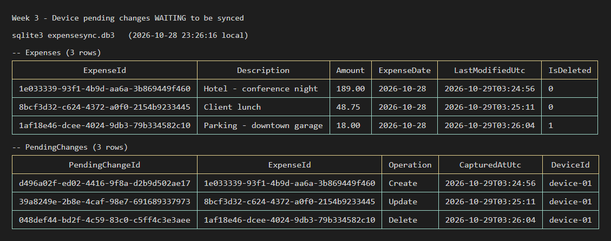 |

Then I made three changes on the device without syncing:

- Added "Hotel - conference night" ($189.00): `Create`
- Changed Client lunch from $42.50 to $48.75: `Update`
- Deleted Parking: `Delete`, and the row stays in `Expenses` with `IsDeleted = 1`

The pending count is 3.

#### 3. Pending changes on the device after a successful send

| Device UI | Device tables |
|---|---|
| 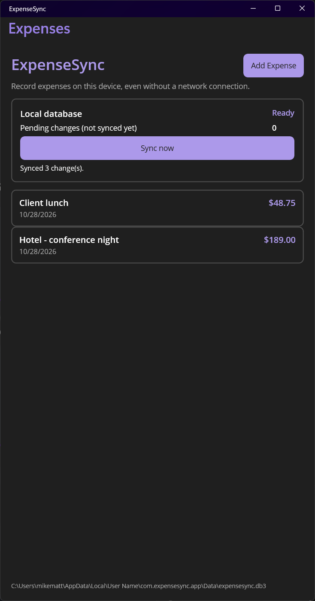 | 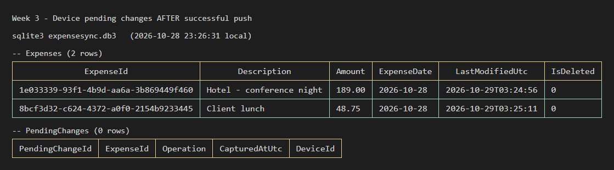 |

After Sync now, the server accepted all three `PendingChangeId`s, so `PendingChanges` is empty and the count is 0. The Parking tombstone was also removed from the device because the server now has the delete.

#### 4. Server tables after receiving the changes

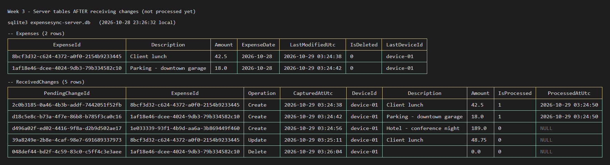

`ReceivedChanges` has three new rows with the same `PendingChangeId`s the device sent, all with `IsProcessed = 0`. The server stores GUIDs in upper case; the dump shows them in lower case so they match the device. `Expenses` has not changed yet: Client lunch is still $42.50 and Parking is not deleted.

#### 5. Server tables after processing the changes

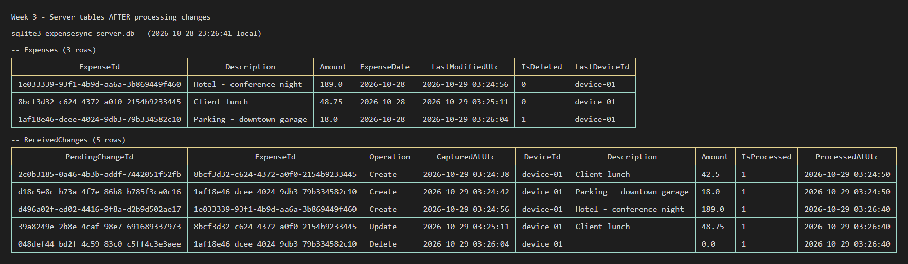

After `POST /api/sync/process` (`{"processedCount":3}`):

- Hotel was added
- Client lunch is $48.75 with the device's `LastModifiedUtc`
- Parking has `IsDeleted = 1`

Every `ReceivedChanges` row now has `IsProcessed = 1` and a `ProcessedAtUtc`.

### Other testing

- With the API stopped, Sync now showed "Sync failed: ... Pending changes were kept." and the pending rows were unchanged. Starting the API and tapping Sync now sent them.
- A Python script sent the push and process requests directly and checked the database after each one: creates stored unprocessed with `Expenses` untouched, a full retry of an already stored push (same ID accepted again, no duplicate row), an empty `deviceId` (`400`), an `Update` with no payload (`400`), processing creates, then pushing and processing an update and a delete. All 13 checks passed.

### Files touched

API:

- `Endpoints/SyncEndpoints.cs`: new, push and process endpoints
- `Models/ReceivedChange.cs`, `Models/ChangeOperation.cs`: new
- `Models/Expense.cs`: added `LastModifiedUtc`, `IsDeleted`, `LastDeviceId`
- `Data/ExpenseSyncDbContext.cs`: `ReceivedChanges` table, `Operation` stored as text
- `Data/Migrations/*AddSyncTracking*`, `*StoreOperationAsText*`: new migrations
- `Program.cs`: maps the sync endpoints and serializes enums as strings
- `ExpenseSync.Api.http`: sample push and process requests

App:

- `Services/SyncService.cs`, `Services/SyncSettings.cs`: new, push client and base URL
- `Data/ExpenseDatabase.cs`: `GetPendingChangesAsync`, `ClearPendingChangesAsync`, new `PendingChangeId` on re-edit
- `ViewModels/MainViewModel.cs`, `Views/MainPage.xaml`: Sync now button and status text
- `MauiProgram.cs`, `ExpenseSync.App.csproj`: typed `HttpClient` registration (`Microsoft.Extensions.Http`)

### Scope at the end of Week 3

At the end of Week 3, conflict handling, automatic server processing, audit logs, connectivity-triggered sync, and the shared Dev Tunnel demo were still pending. The Week 5 section below documents their completion.

## Week 4 Progress: Pull Sync

In Week 4, the app ran a push followed by a pull when the user tapped Sync now. The server exposes `GET /changes?since=<UTC timestamp>` and returns expense rows ordered by `ServerUpdatedUtc`, including delete tombstones. The cursor is read on the server before the query; the app stores the returned `serverTimeUtc` only after it applies the complete downloaded batch.

### Submission checklist

- [x] Pull endpoint (`GET /changes`)
- [x] Apply incoming creates and updates on the device
- [x] Apply deletes as tombstones and hide them from the expense list
- [x] Application name and description at the top of this README
- [x] Week 1, Week 2, Week 3, and Week 4 progress documentation
- [x] All five required database screenshots, with captions below

### Pull response

`since` is optional for the first pull. When provided, it must be an ISO 8601 UTC timestamp ending in `Z`. Invalid values return a `400` validation problem. The server filters by `ServerUpdatedUtc`, rather than the device-captured `LastModifiedUtc`, so changes uploaded late are still discoverable.

```json
{
  "changes": [
    {
      "expenseId": "8bcf3d32-c624-4372-a0f0-2154b9233445",
      "description": "Client lunch",
      "amount": 48.75,
      "expenseDate": "2026-10-28",
      "lastModifiedUtc": "2026-10-29T03:25:11.270Z",
      "isDeleted": false,
      "lastDeviceId": "device-02",
      "serverUpdatedUtc": "2026-11-03T18:05:42.120Z"
    }
  ],
  "serverTimeUtc": "2026-11-03T18:10:00.000Z"
}
```

### Device pull and apply flow

```text
Sync now
   |
   |-- push PendingChanges to POST /pushChanges
   |      '-- remove only server-acknowledged rows
   |
   |-- read SyncState.LastSyncUtc
   |-- GET /changes?since=LastSyncUtc
   |-- save response rows to IncomingChanges (unprocessed)
   |-- apply rows in ServerUpdatedUtc order
   |      |-- skip an expense that still has a PendingChanges row
   |      |-- insert a new expense
   |      |-- update an existing expense
   |      '-- apply a delete as an IsDeleted tombstone
   '-- mark incoming rows processed and advance LastSyncUtc in one transaction
```

Pulled changes do not create `PendingChanges`. If pull or apply fails, the previous `LastSyncUtc` is retained. The app displays one combined sent/received status after the sync and refreshes the expense list and pending count. `POST /api/sync/push` remains available as an alias. In Week 5, push also processes the server inbox automatically and replaces the Week 4 `Skipped` rule.

Device IDs are selected by target: Android builds use `device-02`; other platforms use `device-01`. The Android base URL remains the emulator address (`http://10.0.2.2:5157/`). The evidence below uses the actual Windows MAUI app as the receiving device (`device-01`) and API requests labeled `device-02` to represent changes from another device. It does not claim a physical Android or Dev Tunnel test.

### Week 4 evidence

These are images of actual SQLite query output, in the same table-dump style as Weeks 2 and 3. The server ran with a separate test database. The device tables came from the Windows app's own `expensesync.db3`, backed up before testing. GUIDs are shown in lower case so they can be matched between server and device.

The original device database was restored from its backup after the test. The screenshots show the test data, not the current database contents.

#### Test sequence

1. Start the API with a fresh test database. Prepare a backed-up device database with no expenses, pending changes, or previous sync cursor.
2. Push two `Create` changes as `device-02`: Client lunch ($42.50) and Parking ($18.00). Call `POST /api/sync/process`.
3. In the Windows app, tap Sync now. It downloads both expenses and stores its first cursor. The two processed incoming rows are retained as history.
4. As `device-02`, push Hotel - conference night ($189.00) as `Create`, Client lunch ($48.75) as `Update`, and Parking as `Delete`. Call `/api/sync/process` again.
5. Capture the server and device tables before the second device pull.
6. Tap Sync now on Windows. Pause after `PullAsync` has stored the three received rows, before `ApplyIncomingChangesAsync`, and capture the staged incoming batch.
7. Resume processing. Capture the device tables, then the unchanged server tables.

A temporary Debug-only pause was used for step 6 and removed afterward. The final app was rebuilt and retested without that pause. The normal Sync now action always runs push, pull, and apply together.

#### 1. Server tables before the device pulls

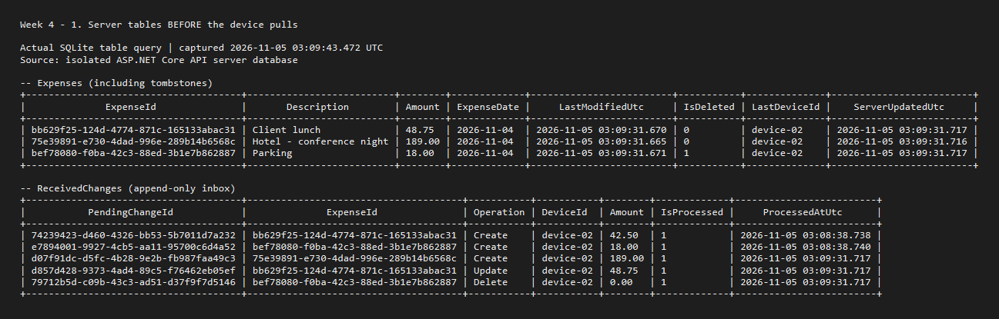

The server already has Hotel, Client lunch at $48.75, and Parking with `IsDeleted = 1`. All three `ServerUpdatedUtc` values are later than the device's previous cursor (`03:09:06.643 UTC`). `ReceivedChanges` contains the two initial creates plus the create/update/delete batch, all processed.

#### 2. Device tables before data is pulled

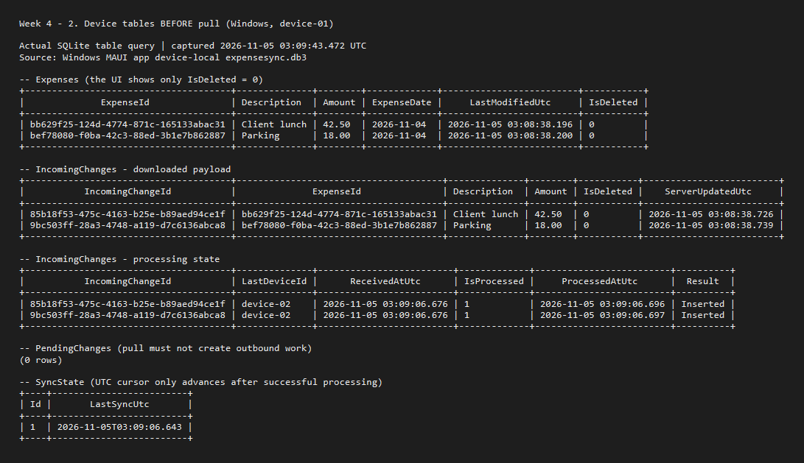

Client lunch is the existing record that will be updated: it is still $42.50 locally. Hotel is the new server record and is not on the device yet. Parking is still undeleted. There are no pending changes. The two incoming rows shown are already-processed history from the initial download, not the next batch.

#### 3. Device tables after data is pulled, before processing

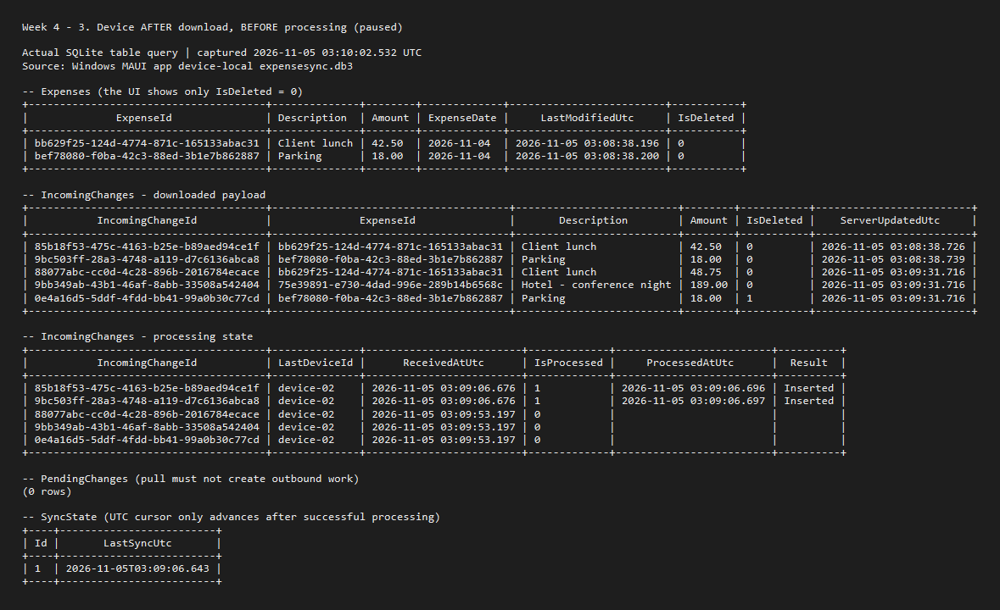

Three additional `IncomingChanges` rows contain Hotel ($189.00), lunch ($48.75), and the Parking tombstone. They have `IsProcessed = 0`, no `ProcessedAtUtc`, and no `Result`. The local `Expenses` table and `LastSyncUtc` have not changed yet. Downloading alone creates no `PendingChanges`.

#### 4. Device tables after data is processed

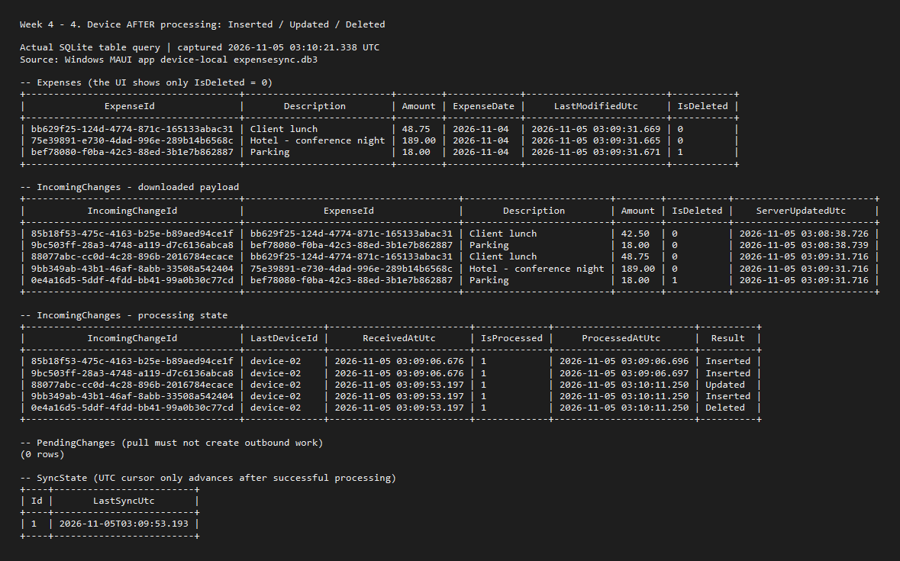

Hotel is inserted, lunch is $48.75, and Parking has `IsDeleted = 1`. The three new incoming rows have results `Inserted`, `Updated`, and `Deleted`, with processing timestamps. `PendingChanges` is still empty. `LastSyncUtc` has advanced from `03:09:06.643` to `03:09:53.193 UTC`, the server cursor returned for this pull. DevFlow also confirmed that the UI displayed only lunch and Hotel, with "Sent 0, received 3 change(s)."

#### 5. Server tables after successful download

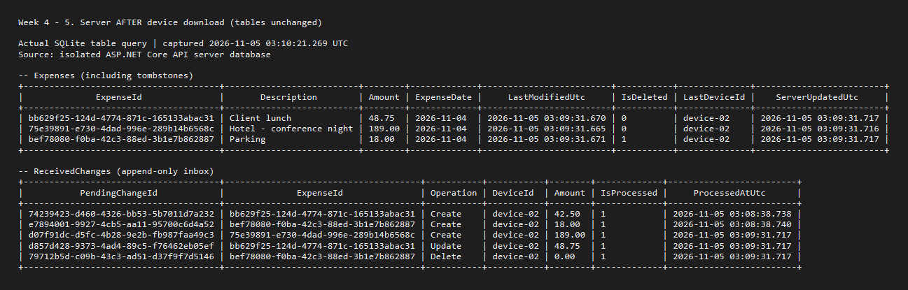

The server rows match screenshot 1. Pull is read-only: it does not delete expenses or alter receipt/processing flags. A comparison of the complete SQLite dumps before and after the device pull found no differences.

### Other testing and files

Verified on Windows with the real app, API, and SQLite files:

- Initial pull inserted both baseline expenses without creating outbound pending changes.
- Incremental pull downloaded exactly the new expense, update, and delete. Processing updated all three correctly and hid Parking from the UI.
- An intentional SQLite trigger failure during the second of two updates rolled back the entire apply transaction. Neither expense changed, both incoming rows stayed unprocessed, and `LastSyncUtc` stayed unchanged. Removing the trigger and retrying applied both updates without duplicating the failed batch.
- Editing lunch through the UI after download but before apply created a real pending edit. Apply marked the incoming lunch version `Skipped`, kept the local $60.00 edit, and retained its pending row. This is the Week 4 pending-change protection rule, not Week 5 conflict resolution.
- With the API stopped, push kept the pending edit and displayed a failure. Restarting the API and syncing with the final, uninstrumented build sent it successfully.
- With no pending edits and the API stopped, pull left `LastSyncUtc` unchanged and did not generate pending changes.
- Three valid UTC cursor formats (whole seconds, milliseconds, and seven fractional digits) returned `200`. Six invalid cases (date only, natural-language date, malformed text, non-UTC offset, missing zone, and empty value) returned `400`.
- All 24 assertions against the captured database snapshots passed. An exact replay with the final build reproduced the same expense values and tombstones without the temporary pause.
- A repeated sync after that replay downloaded no further changes and created no duplicate incoming or pending rows. The pull response's exact JSON field names, empty-batch response, and validation-problem error shape were also checked.
- Existing server data initially had default `ServerUpdatedUtc` values. A follow-up EF migration backfills those from `LastModifiedUtc`; a filtered pull after migration returned the expected Parking tombstone.
- API, Windows MAUI, and Android target builds passed with zero warnings and zero errors. Runtime evidence is from Windows; Android was compile-checked, not run.

Files:

- App: `DeviceSettings.cs` selects the Week 4 device IDs; `SyncSettings.cs` still contains the localhost/emulator URLs; `SyncService.cs`, `ExpenseDatabase.cs`, `SyncState.cs`, and `IncomingChange.cs` implement the push/pull/apply flow.
- API: `Endpoints/SyncEndpoints.cs` provides the pull endpoint, push alias, and processing endpoint; `Models/Expense.cs` and the EF migrations track/backfill `ServerUpdatedUtc`; `ExpenseSync.Api.http` contains pull and push samples.
- Evidence: `docs/images/week4-db-01-server-before.png` through `week4-db-05-server-after.png`.

### Not done yet

Conflict resolution, audit logging, and connectivity-triggered sync are implemented in Week 5. A Windows-and-Android demo through a temporary Dev Tunnel verified the conflict strategy, audit trail, and offline/online automatic sync.

## Week 5 Progress: Conflicts, Audit Log, Automatic Sync

### Submission checklist

- [x] Implement last-captured-on-device conflict handling.
- [x] Record local audit entries and send them to the server.
- [x] Use the same coordinator for Sync now and connectivity-triggered attempts.
- [x] Document the Week 5 implementation and test procedure.
- [x] Configure and verify a temporary Dev Tunnel from the PC, Windows, and Android for the demo.
- [x] Capture the conflict, audit, and online/offline automatic-sync evidence below.
- [x] Prepare the rendered README screenshot and zipped `.git` archive.
- [ ] Upload the README screenshot and `.git` archive to Canvas.

### Conflict handling and audit

The server processes the inbox during `POST /pushChanges`. The separately callable `/api/sync/process` endpoint remains available. A device change is applied only when its captured `LastModifiedUtc` is later than the server's; a delete uses `CapturedAtUtc`. Equal timestamps keep the server version. `ReceivedChanges.Result` records `Applied` or `RejectedOlder`, and `ServerLastModifiedUtc` records the value used for the comparison. A rejected row is acknowledged, and the server refreshes the winning expense's `ServerUpdatedUtc` so the losing device can pull it.

During pull, a pending local edit is retained when it is newer than the incoming version (`ConflictLocalWins`). An incoming version that is newer or equal is applied and the pending row is removed (`ConflictServerWins`). Pulls do not create pending changes or audit entries. The API serializes sync operations within its single process so simultaneous devices cannot overwrite a newer captured version with an older one.

Each local create, update, and delete writes an `AuditEntries` row in the same SQLite transaction as the expense and pending change. Entries include the operation, UTC time, device ID, user ID, and a short description. Windows uses `device-01` / `user-01`; Android uses `device-02` / `user-02`. Audit rows stay on the device after synchronization; only `IsSynced` and `SyncedAtUtc` change. The server stores each audit ID once, including on retries.

A create deleted before any push attempt is removed locally, but both audit events remain. Once a create has been attempted, its deletion stays queued as a tombstone: the server may have received the create even if its response was lost. Pending changes and their expense payloads are captured together before sending. Existing pending creates from older app versions are conservatively treated as possibly sent. Unlike the original Week 5 plan, the server also keeps a tombstone when a delete arrives before any server row; this prevents an older, delayed create from resurrecting the expense.

### Push contract

The request may contain changes, audit entries, or both. An empty request is rejected. Older clients may omit `auditEntries`.

```json
{
  "deviceId": "device-01",
  "changes": [{
    "pendingChangeId": "11111111-1111-1111-1111-111111111111",
    "expenseId": "22222222-2222-2222-2222-222222222222",
    "operation": "Update",
    "capturedAtUtc": "2026-11-10T15:02:10Z",
    "expense": {
      "description": "Client lunch",
      "amount": 60.00,
      "expenseDate": "2026-10-28",
      "lastModifiedUtc": "2026-11-10T15:02:10Z"
    }
  }],
  "auditEntries": [{
    "auditEntryId": "33333333-3333-3333-3333-333333333333",
    "expenseId": "22222222-2222-2222-2222-222222222222",
    "operation": "Update",
    "occurredAtUtc": "2026-11-10T15:02:10Z",
    "deviceId": "device-01",
    "userId": "user-01",
    "details": "Amount 48.75 -> 60.00"
  }]
}
```

```json
{
  "acceptedPendingChangeIds": ["11111111-1111-1111-1111-111111111111"],
  "acceptedAuditEntryIds": ["33333333-3333-3333-3333-333333333333"],
  "results": [{
    "pendingChangeId": "11111111-1111-1111-1111-111111111111",
    "expenseId": "22222222-2222-2222-2222-222222222222",
    "result": "Applied"
  }],
  "serverTimeUtc": "2026-11-10T15:05:00Z"
}
```

Only acknowledged pending and audit IDs are cleared or marked synced. A failed request retains the unacknowledged work for retry.

### Automatic sync

```text
Sync now (Manual) ----\
                       -> SyncCoordinator -> online: push, pull, apply
Connectivity (Auto) --/                   -> offline: keep pending work
                                      -> record SyncAttempts and refresh UI
```

The singleton coordinator starts with the app and listens for changes to `NetworkAccess`. Duplicate events with the same access value are ignored. A semaphore prevents overlapping syncs: another manual request returns "Sync already running." If connectivity changes during a sync, the latest automatic trigger is retried after that sync finishes. An offline attempt never calls the API.

`SyncAttempts` records the trigger, UTC start time, network access, success, sent and received counts, pending count afterward, and message. The main page shows the current network state and last attempt. The offline count reflects the moment the attempt ran; an edit made afterward does not rewrite that historical attempt. A pull can include the device's own just-uploaded expense, so its received count is not necessarily zero.

### Shared API setup and test script

For the captured demo, the API ran with a fresh SQLite database in the Windows temp directory and a temporary, anonymous HTTPS Dev Tunnel. The local and tunnel `/health` endpoints were checked, and both MAUI apps reached that same API. The URL was not committed; the temporary tunnel was stopped and removed after capture. To repeat the demo with the group server, set `SharedDevTunnelUrl` in `src/ExpenseSync.App/Services/SyncSettings.cs` to the group's HTTPS URL before building both apps. Do not put access tokens in source.

The demo used synthetic expenses and the isolated server database `expensesync-week5-demo.db` under the Windows temp directory. The Android emulator app data was cleared with permission before testing. The PC network was left connected; only emulator connectivity was toggled.

#### Captured two-device demo

1. On Android (`device-02`), create Client lunch ($48.75) and Parking ($18.00), then tap Sync now.
2. Change Client lunch to $55.00 on Android, then disconnect only the emulator. Its automatic offline attempt records one pending update.
3. While Android is offline, sync Windows (`device-01`), change the same shared lunch expense to $60.00, and sync again.
4. Reconnect Android without tapping Sync now. Its automatic attempt sends the older $55.00 update, the server records `RejectedOlder`, and Android pulls the later $60.00 version. The Windows and Android rows converge on $60.00 with empty pending queues.
5. Capture the local Android audit table and the server audit table. Both include the conflicting edits and their device/user IDs.

The Android offline evidence is an actual app screenshot and SQLite snapshot. The online screenshot shows the automatic attempt, the rejected older edit, the pulled $60.00 value, and zero pending changes. The Windows app was run against the same temporary tunnel; its local database contains the $60.00 edit and synced audit row.

### Supplemental Android evidence

These two supplemental SQLite dumps are from an earlier Android emulator test with a separate isolated local API. They are retained as additional evidence, distinct from the Dev Tunnel demo evidence below.

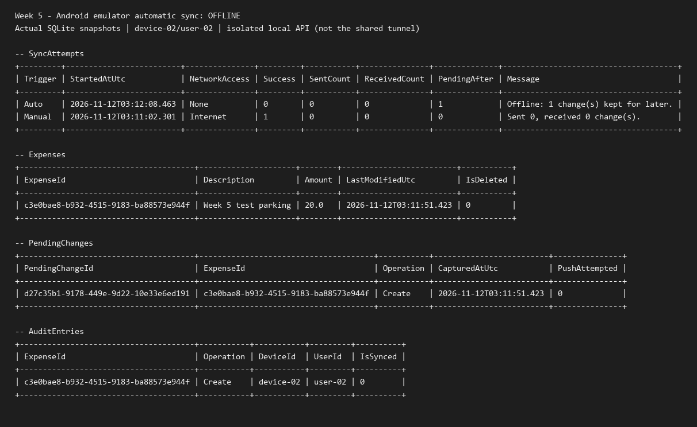

The offline automatic attempt recorded one pending create and an unsynced audit entry.

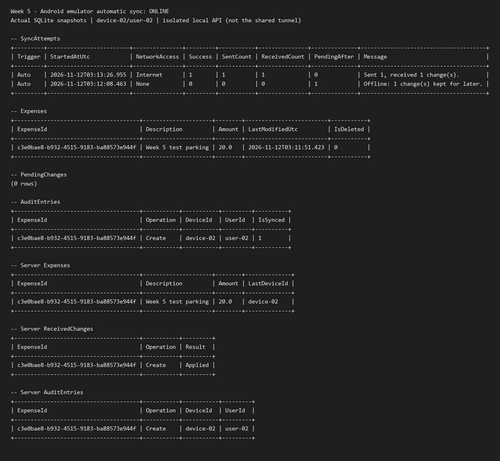

After reconnecting, the automatic attempt sent the create, cleared the pending queue, and synced the audit entry to the test server.

### Week 5 demo evidence

#### Conflict strategy

| Before Android reconnects | After automatic conflict resolution |
|---|---|
| 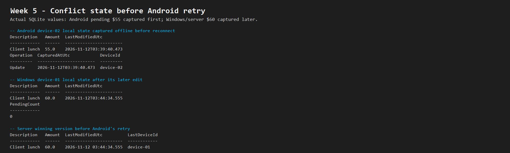 | 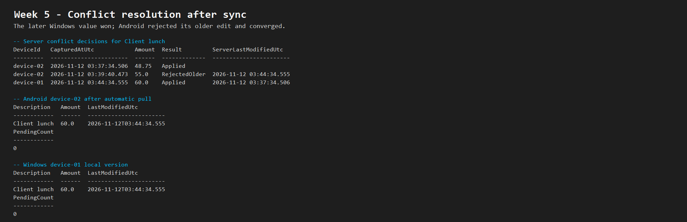 |

#### Audit trail

| Android device audit log | Server audit log |
|---|---|
| 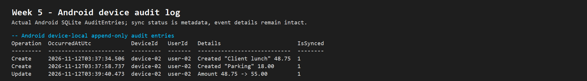 | 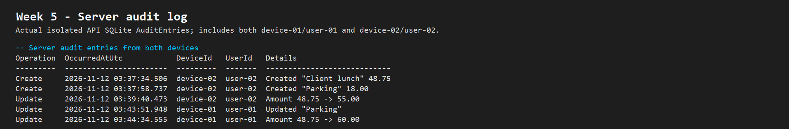 |

#### Automatic sync

| Offline attempt | Online attempt after reconnect |
|---|---|
| 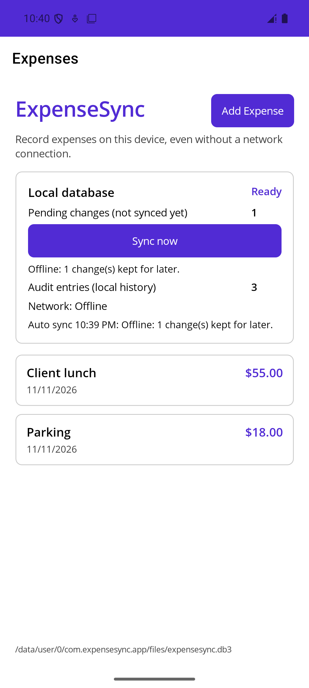 | 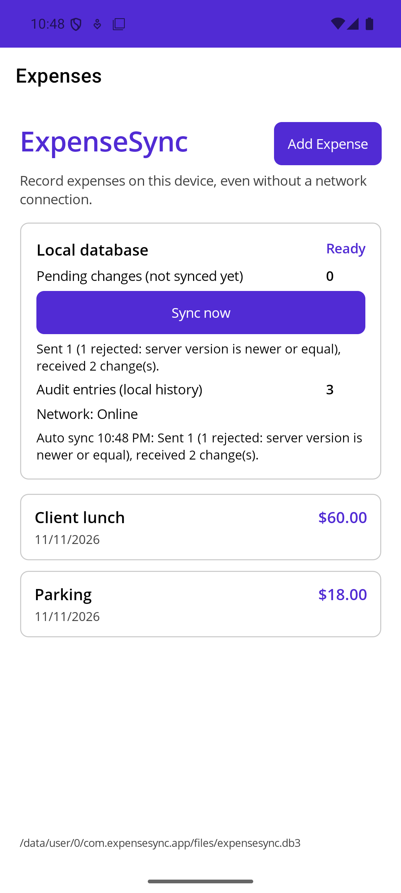 |

| Offline SQLite state | Online SQLite state |
|---|---|
| 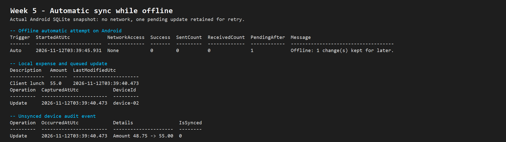 | 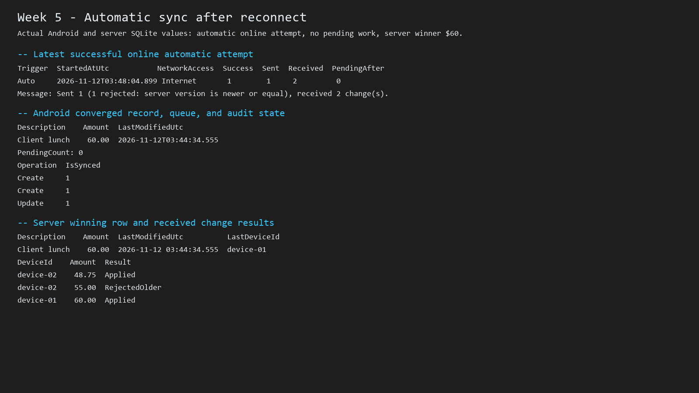 |

### Other testing and limitations

Run `dotnet test tests\ExpenseSync.Tests\ExpenseSync.Tests.csproj` for isolated API and device-database tests covering conflict order and ties, concurrent pushes, audit retries, pull conflicts, in-flight deletion, a delete arriving before an older create, automatic offline/online attempts, failed-server retry, and overlapping syncs. These tests use synthetic data, a temporary local API, and simulated connectivity; they are not a substitute for the two-device screenshots.

The demo's automatic network changes were verified in the running Android app through DevFlow and in its SQLite `SyncAttempts` table. The Windows app's local SQLite record and audit row were also checked. The screenshots above are from the temporary Dev Tunnel demo; the earlier supplemental Android screenshots use a different local API and test record. The demo expense and sync cursor remain in the emulator's app database; prepare a fresh database before using another server.

The conflict rule assumes device clocks are reasonably accurate. Automatic sync runs only while the app process is running; there is no background job for a suspended or closed app. Connectivity reporting internet access does not guarantee that the API or tunnel is reachable. The server-side sync lock assumes one API process, as in the shared demo setup.

Files: API `Endpoints/SyncEndpoints.cs` and the Week 5 migration; app `Data/ExpenseDatabase.cs`, `Models/SyncAttempt.cs`, `Models/PendingChange.cs`, `Services/SyncCoordinator.cs`, `Services/SyncService.cs`, `Services/SyncSettings.cs`, `ViewModels/MainViewModel.cs`, and `Views/MainPage.xaml`; tests in `tests/ExpenseSync.Tests`.
